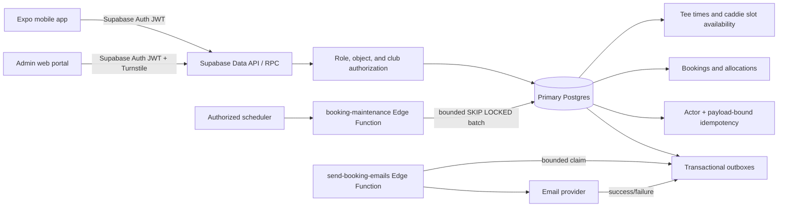
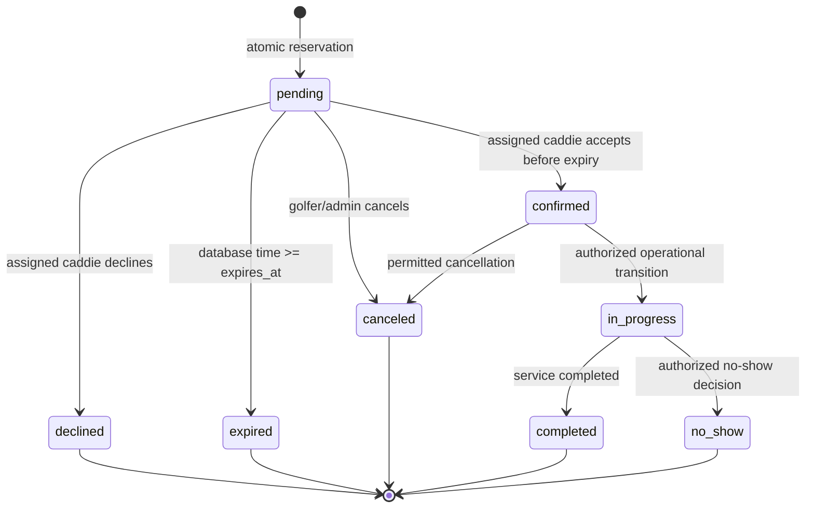

# NoBogey booking backend: Rewired #1

Status: repository implementation only. The October 13, 2026 migration and Edge Function changes in this branch have **not** been applied to production. Production deployment, secret creation, scheduler setup, and load tests require an explicitly authorized maintenance window.

## Current audit

Before this increment, NoBogey already had Supabase Auth, RLS-protected booking reads, caddie overlap exclusion constraints, a caddie response RPC, a notification email outbox, and administrator RPCs. The important gaps were:

- tee-time capacity was represented by a single-booking unique index rather than allocated units;
- pending requests had no expiry and continued blocking the caddie indefinitely;
- idempotency keys were unique per golfer but were not bound to the operation payload;
- caddie availability was a broad time range rather than a declaration against a published tee time;
- availability search and booking validation did not share all cutoff, expiry, and capacity rules;
- notification claims could remain stuck in `sending`, and failures retried immediately without backoff;
- the administrator tee-time editor wrote generic JSON state instead of the authoritative tee-time API;
- the admin role check referenced the nonexistent `club_admin` enum value instead of `club_manager`.

## Explicit business-rule configuration

These rules need product/club confirmation, so they are isolated in the singleton `public.booking_policy` row instead of being hidden in application code:

| Setting | Repository default | Meaning |
|---|---:|---|
| `capacity_unit` | `golfers` | A request consumes its party size. Can be changed to one unit per booking. |
| `reserve_tee_time_inventory` | `false` | NoBogey reserves caddie services only and does not claim that it owns the club's tee sheet. Enable only with club authorization. |
| `hold_minutes` | `15` | A pending caddie request expires after 15 minutes. |
| `service_buffer_minutes` | `30` | Prevents adjacent assignments inside the travel/reporting buffer. |
| `max_pending_per_golfer` | `3` | Limits inventory hoarding by one golfer. |

All timestamps are `timestamptz` and stored as UTC. Search-day conversion uses the golf club's IANA timezone; existing Philippine clubs default to `Asia/Manila`.

## Architecture

Postgres is authoritative for reservation success. The browser, mobile cache, Realtime, and email provider do not allocate capacity. API and Edge Function instances remain stateless. External calls never occur inside booking transactions.

## Booking state machine

The persisted spelling `canceled` remains for backwards compatibility; it represents the product-level `CANCELLED` state.

Decline, expiry, and cancellation call one conditional allocation update (`released_at is null`). Replays therefore do not release twice. Confirmation keeps the allocation. Acceptance after expiry commits `expired` and returns that authoritative booking instead of rolling the expiry back with an exception.

## Canonical contracts

### Publish a tee time

`publish_tee_time(course_id, starts_at, ends_at, booking_cutoff_at, capacity)`

- caller must manage the course's club or be a platform administrator;
- all timestamps and capacity are server validated;
- direct client-controlled ownership, status, or price fields are not accepted.

### Declare caddie availability

`set_caddie_tee_time_availability(tee_time_ids[])`

- caller must be the caddie;
- every slot must be future, open, and in a club where that caddie has a verified assignment;
- active booking slots cannot be removed.

### Search availability

`list_bookable_tee_times(course_id, day, page_size, after)`

- one indexed, bounded, cursor-compatible query;
- filters inactive clubs/courses, cutoff slots, unavailable caddies, current allocations, and expired pending holds;
- maximum page size is 100;
- results are advisory and are revalidated inside booking creation.

### Create booking

`create_mobile_booking(tee_time_id, caddie_id, party_size, idempotency_key)`

The transaction locks the tee time, expires stale conflicting holds, validates actor role, cutoff, caddie verification, exact declared availability, overlap buffer, pending-request limit, and configured capacity. It then writes the booking, allocation, history, idempotency result, and `booking.requested` event atomically. Conflicts return SQLSTATE `23P01`; success is returned only after commit.

The idempotency identity is `(authenticated actor, operation, key)`. A SHA-256 fingerprint binds the key to tee time, caddie, and party size. Reusing it with another payload returns `IDEMPOTENCY_KEY_REUSED`.

## Concurrency and delayed workers

- Tee-time reservation locks the slot, golfer, and caddie rows in that order. The golfer lock makes the pending-request limit race-safe; the caddie lock serializes buffer checks across different slots.
- Active caddie overlaps retain the database exclusion constraint; the serialized RPC also applies the configured buffer.
- Expired pending allocations are excluded using `expires_at > now()` even if the worker is delayed.
- Every create attempt first expires stale holds for the requested tee time/caddie, so old exclusion rows are transitioned before insert.
- The mobile client retries only serialization failures and deadlocks, at most twice, with backoff and jitter while reusing the same idempotency key; business conflicts are never retried.
- The maintenance worker processes ordered, bounded batches using `FOR UPDATE SKIP LOCKED`; several workers can run safely.
- Email claims use the same pattern, reclaim locks older than five minutes, apply capped exponential backoff plus jitter, and dead-letter after eight attempts. Resend calls use the outbox ID as a stable provider idempotency key so a reclaimed lease cannot duplicate delivery during the provider's retry window.

## Threat model and controls

| Threat | Control |
|---|---|
| Booking or canceling for another golfer | Actor comes from `auth.uid()`; cancellation checks ownership/admin role. |
| Responding as another caddie | Response RPC locks the booking and compares `caddie_id` with `auth.uid()`. |
| Cross-club administration | Course-to-club resolution plus `private.manages_club`; caddie activity, reviews, and compliance events are club-scoped; no caller-supplied club authorization. |
| Capacity race | Tee-time row lock, authoritative allocation sum, exclusion constraint, one transaction. |
| Retry creates duplicates | Actor/operation/key uniqueness plus payload fingerprint. |
| Inventory hoarding | Configured per-golfer pending limit and short database-timed expiry. |
| Public privileged RPC execution | `anon`/`PUBLIC` execute revoked; each definer RPC performs explicit actor/role checks and pins `search_path`. |
| Mass assignment | RPCs expose narrow parameters; server owns price, status, owner, timestamps, and event payload. |
| Notification provider outage | Booking commits independently; retryable outbox tracks delivery separately. |
| Secret leakage | Only publishable keys are client visible; service keys and dispatch secrets are Edge Function secrets. |
| PII in logs | Event payloads contain IDs, not email/password/payment data; delivery errors are truncated. |

Admin and super-admin accounts should require Supabase MFA/AAL2 before production privileged mutations. That dashboard/Auth policy is external configuration and is not claimed as deployed here. See [Supabase RLS guidance](https://supabase.com/docs/guides/database/postgres/row-level-security) and [MFA assurance levels](https://supabase.com/docs/guides/auth/auth-mfa).

## Network and deployment controls

- `nobogeyofficial.com` and the Supabase custom API domain terminate TLS at managed providers.
- Static landing/admin assets may be CDN cached; authenticated API and booking responses must use `private, no-store` and must never be cached publicly.
- Cloudflare WAF/DDoS protection and Turnstile protect the public/admin edge. Add shared Cloudflare rate limits for auth, availability search, booking RPC traffic, and exports before production rollout.
- Trust only provider-supplied client-IP metadata at the edge; do not honor arbitrary `X-Forwarded-For` in application logic.
- Use Supabase's transaction pooler for stateless workloads. A provisional budget is 60 pooled application connections, 10 worker connections, and 10 operational headroom; revise after measuring the actual database instance limit.
- Recommended timeouts: 5 s statement, 2 s lock, 10 s external email call, 5 minute outbox lease.

The email dispatcher now enforces its 10-second provider timeout. Database statement/lock timeouts remain an environment-level rollout item because changing the shared hosted role without measuring the rest of the application could break unrelated queries.

## Environment variables

| Variable | Scope | Purpose |
|---|---|---|
| `EXPO_PUBLIC_SUPABASE_URL` | Mobile/public | Supabase API base URL; safe to embed. |
| `EXPO_PUBLIC_SUPABASE_PUBLISHABLE_KEY` | Mobile/public | Publishable client key; authorization still depends on RLS. |
| `EXPO_PUBLIC_APP_URL` | Mobile/public | HTTPS web/deep-link origin. |
| `VITE_SUPABASE_URL` | Admin/public | Supabase API base URL; safe to embed. |
| `VITE_SUPABASE_PUBLISHABLE_KEY` | Admin/public | Publishable client key; never replace with a service-role key. |
| `VITE_TURNSTILE_SITE_KEY` | Admin/public | Cloudflare Turnstile site key. |
| `SUPABASE_SERVICE_ROLE_KEY` | Edge secret | Server-only maintenance/outbox database access. |
| `RESEND_API_KEY` | Edge secret | Server-only email provider credential. |
| `BOOKING_EMAIL_FROM` | Edge secret/config | Verified sender identity. |
| `OUTBOX_DISPATCH_SECRET` | Edge secret | Authenticates scheduler calls to email dispatch. |
| `BOOKING_MAINTENANCE_SECRET` | Edge secret | Separate credential for booking maintenance calls. |
| `LOAD_TEST_DATABASE_URL` and fixture IDs | Local/staging only | Direct database target and hot-slot fixtures for the contention harness. |

Use separate values per environment, rotate server secrets after suspected disclosure, and never prefix server secrets with `EXPO_PUBLIC_` or `VITE_`. Repository example files contain placeholders only for new server secrets.

## Deployment and forward recovery

1. Back up production and record the latest verified restore timestamp.
2. Apply `booking_status_values` first, then `booking_workflow_reliability` during a maintenance window.
3. Verify constraints, grants, advisor output, canonical search, create/accept/cancel/expire paths, and outbox claims.
4. Deploy `booking-maintenance` and the updated `send-booking-emails` functions with separate random secrets.
5. Schedule maintenance every minute and email dispatch at a rate compatible with the provider quota.
6. Deploy mobile/admin clients only after the database is backward-compatible.

The migrations are additive. If application rollout fails, roll clients back while leaving the new tables/columns in place. Do not drop data to roll back. Forward recovery means correcting functions/policies in a new migration. A full database restore is reserved for migration-level corruption.

Proposed initial objectives, pending business approval: RPO 15 minutes and RTO 2 hours. Verify restore quarterly into an isolated project, run schema checks and a sampled booking reconciliation, then record duration and evidence.

Supabase daily backups alone do not meet a 15-minute RPO. The production project therefore needs PITR or an equivalent WAL-based recovery service before that objective can be claimed. As of October 13, 2026, Supabase documents seven days of daily backup retention for Pro and finer-grained PITR as an add-on; Storage objects need an independent recovery plan because a database restore restores their metadata, not deleted objects. See [Supabase database backups](https://supabase.com/docs/guides/platform/backups).

## Observability and alerts

Track structured fields `request_id`, `actor_id`, `operation`, `booking_id`, `tee_time_id`, `outcome`, and latency; never log tokens, passwords, email bodies, payment payloads, or unnecessary PII.

Minimum alerts:

- booking RPC p95 > 750 ms for 10 minutes or error rate > 2%;
- lock wait p95 > 500 ms or deadlocks > 0;
- oldest pending booking event/email > 5 minutes;
- dead-letter count > 0;
- expiration delay > 2 minutes;
- database connections > 80% of budget;
- backup/restore verification overdue by 90 days.

Runbooks: reduce admission/concurrency before retrying during overload; do not retry conflicts; pause workers if the provider is failing; replay only undelivered deduplication keys; never mutate booking state manually without an audited admin operation.

## Verification and provisional load profile

Database tests are in `supabase/tests/database/booking_workflow_reliability.test.sql`. The contention harness is `scripts/load/booking-contention.mjs`. It rejects the known production endpoint and requires `ALLOW_STAGING_LOAD_TEST=true` outside localhost.

Until a traffic target is approved, use this provisional authorized-staging profile:

- dataset: 10 clubs, 40 courses, 10,000 tee times, 1,000 caddies, 10,000 golfers;
- mix: 80% availability reads, 15% booking detail reads, 5% booking writes;
- contention: 25 simultaneous requests against the final configured capacity of one hot slot;
- report p50/p95/p99, throughput, conflict rate, unexpected error rate, connections, CPU, lock waits, and the final authoritative allocation sum.

No throughput or latency result is reported yet because the repository has no authorized local/staging database target in this task. Never infer production capacity from frontend unit tests.

### Results from this repository pass

| Check | Result |
|---|---|
| Shared contracts TypeScript | Passed |
| Admin TypeScript | Passed |
| Mobile TypeScript | Passed |
| Vitest application suite | Passed: 51 tests |
| Edited TypeScript ESLint | Passed |
| Admin production build | Passed |
| Expo web export | Passed: 59 routes |
| SQL delimiter/function structural check | Passed: 23 balanced function bodies |
| pgTAP integration suite | Attempted; blocked because Docker/Podman and a local Postgres runtime are unavailable |
| SQL lint and `EXPLAIN (ANALYZE, BUFFERS)` | Not run: no authorized local/staging database target |
| Contention load test | Not run: no authorized local/staging database target |

These are repository checks, not production verification. The pgTAP suite now contains 48 assertions covering grants, actor and cross-club isolation, safe caddie-directory access, idempotency, stale-search conflicts, acceptance, invalid transitions, tee-time edit protection, cancellation/release replay, expiration, event replay, and notification-provider failure retention.

### Query-plan analysis to verify after migration

The canonical paths are intentionally aligned to existing or new indexes:

| Query path | Expected supporting index |
|---|---|
| Course/day tee-time scan | `tee_times(course_id, starts_at)` unique index |
| Exact caddie declarations | `caddie_tee_time_availability` primary key and caddie index |
| Active caddie overlap | GiST exclusion index plus `bookings_caddie_starts_idx` |
| Active capacity sum | `booking_allocations_capacity_idx` |
| Pending expiration worker | `bookings_expiration_idx` |
| Club CRM timeline | `bookings_course_starts_idx` |
| Outbox claim | partial dispatch indexes ordered by `available_at` |

This is a structural index review, not a measured plan. Capture `EXPLAIN (ANALYZE, BUFFERS)` on representative staging data and reject the rollout if hot paths fall back to large sequential scans, spill sorts, or lock waits above the alert thresholds.

## Initial cost model

For one production and one staging project in the same Pro organization, a current planning floor is about USD 35/month with two Micro databases, or about USD 40/month with Small production plus Micro staging, after the documented USD 10 compute credit. Seven-day PITR on production adds roughly USD 100/month, making that second example roughly USD 140/month before the custom domain, email provider, Cloudflare, taxes, storage/egress overages, or enhanced observability. These are October 13, 2026 planning figures, not a quote; validate the billing page before rollout. Sources: [Supabase compute pricing](https://supabase.com/docs/guides/platform/compute-and-disk), [billing FAQ](https://supabase.com/docs/guides/platform/billing-faq), and [backup/PITR pricing](https://supabase.com/docs/guides/platform/backups).

## Remaining external work

- confirm capacity unit and whether NoBogey is authorized to reserve club tee inventory;
- configure admin MFA/AAL2 and privileged-session policy;
- set Edge Function secrets and scheduler calls;
- configure Cloudflare shared rate limits/WAF rules and `Cache-Control` safeguards;
- enable dependency and secret scanning in repository settings;
- review Supabase Security/Performance Advisors after migration;
- execute and archive a restore verification and an authorized staging load-test report.
- keep payment state separate from booking state when the deferred payment phase is implemented; this increment does not claim to collect or settle payments.
